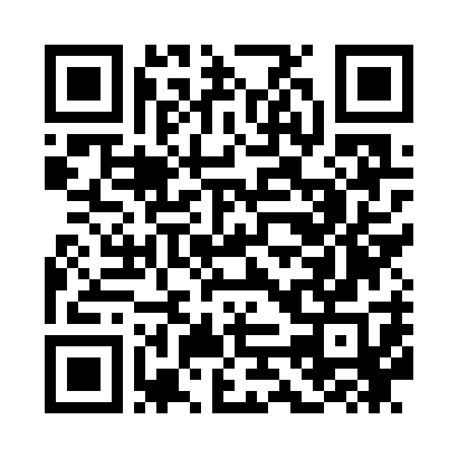

# KAIA Surin — Damper Retrofit & Structural Health Monitoring

[ภาษาไทย](README.th.md) · [한국어](README.ko.md)

This repository explains the damper retrofit and structural health monitoring (SHM) project at **Wanichnukul School in Surin, Thailand**. It is a public introduction for school representatives, engineers and researchers.

**[Open the full dashboard in English](https://mac-macmini.taild8ccd7.ts.net/full.html?lang=en)** · [ภาษาไทย](https://mac-macmini.taild8ccd7.ts.net/full.html?lang=th) · [한국어](https://mac-macmini.taild8ccd7.ts.net/full.html?lang=ko)

Scan with your phone camera. Viewers do not need to install an app or Tailscale.

## What is the project?

The project brings together a **viscous-damper retrofit** and **instrumented observation of the building**. Dampers are intended to dissipate energy during movement; measurements help the team examine building response and damper movement. The retrofit's actual effectiveness must be assessed from reviewed measurements and engineering evidence.

The monitoring system uses four accelerometers with three axes each, wire displacement sensors near dampers, an on-site collection PC, data storage and a read-only web dashboard. Displayed locations remain provisional until field installation is recorded and checked.

| Reader | Start here |
|---|---|
| School representatives | View connection status, the school model and available reports. Contact the project team when observations stop or become old. |
| Engineers | Check the sensor/axis, time, unit, gaps and installation/calibration context before interpreting a trace. |
| Researchers | Ask the project owner for a suitable data period, channel set and quality/installation information. |

## Current stage — 12 October 2026

Field installation and commissioning are pending at this checkpoint. The dashboard is accessible, but access to the page does not establish that live sensors are connected. The team is preparing installation, acquisition/storage checks and network/recovery tests. No structural-safety certification or verified retrofit improvement percentage is reported here.

## Use the dashboard in one minute

1. Open the full link above. Select **English, Thai or Korean**. The requested default/order is English → Thai → Korean; the latest interface changes require rollout to the public service.
2. Start with the summary and school model. A highlighted location is a selection, not evidence that a sensor is online.
3. Open the acceleration and displacement sections. Check **time and LIVE/STALE/OFFLINE** together; missing observations are not zero movement.
4. Read available English/Thai reports and their measurement period. Example/emergency sample reports are labelled synthetic; they are not actual incidents.
5. If observations are unavailable, wait for the field connection and reopen/refresh. The full dashboard automatically requests acceleration every 2 seconds and displacement every 1 second. Sensor collection, the field network and the relay must all be running.

The public page is **read-only**. Viewers cannot change installation zero, restart equipment or operate sensors. Role tabs change the reading view, not access permissions. Receiving data is not a structural safety verdict. Automatic structural interpretation and alert/report delivery are not presented as commissioned capabilities.

## Data sharing

**Measurement data are not uploaded to this public repository. Please ask the project owner; data can be shared on request.**

Explain your purpose, the period/channels and preferred format, and whether you need installation/calibration or quality metadata. The owner will agree the data scope and sharing conditions with you. For research, preserve units, timestamps, gaps and provenance; do not treat interpolated data as original observations.

Contact the [project owner](https://github.com/titoliviomilazzo) directly, or open a [data-request issue](https://github.com/titoliviomilazzo/kaia-surin-damper-shm/issues/new/choose). Issues are public: do not attach private measurements, passwords or personal contact details. Arrange file transfer privately with the owner.

## What this repository contains

Project introduction, dashboard instructions, a share QR and a data-request template. Raw data, internal configurations, recovery backups and credentials are excluded. Installing this repository does not start field acquisition; use the hosted dashboard link.
