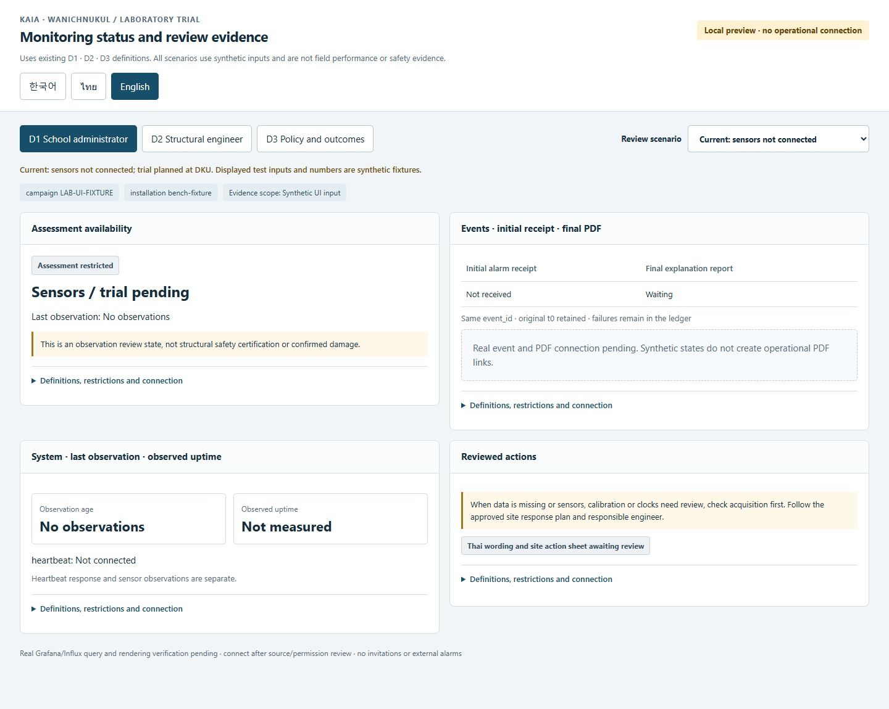
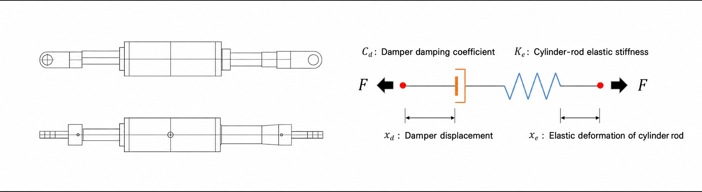
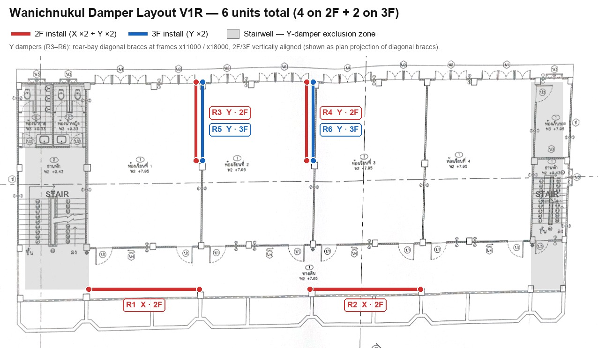

# KAIA Surin — การเสริมอาคารด้วยแดมเปอร์และระบบ SHM

[English](README.md) · [한국어](README.ko.md)

โครงการนี้เป็นการเสริมอาคารด้วยแดมเปอร์หนืดและการติดตามสภาพโครงสร้าง (SHM) ที่ **Wanichnukul School จังหวัดสุรินทร์ ประเทศไทย** เอกสารนี้จัดทำสำหรับผู้แทนโรงเรียน วิศวกร และนักวิจัย

**[เปิดแดชบอร์ดเต็มภาษาไทย](https://mac-macmini.taild8ccd7.ts.net/full.html?lang=th)** · [English](https://mac-macmini.taild8ccd7.ts.net/full.html?lang=en) · [한국어](https://mac-macmini.taild8ccd7.ts.net/full.html?lang=ko)

สแกนด้วยกล้องโทรศัพท์ ไม่ต้องติดตั้งแอปหรือ Tailscale

## โครงการและสถานะปัจจุบัน

แดมเปอร์หนืดมีหน้าที่สลายพลังงานจากการเคลื่อนไหว ระบบ SHM ใช้เซนเซอร์ความเร่ง 4 ตัว ตัวละ 3 แกน พร้อมเซนเซอร์วัดระยะเคลื่อนตัว คอมพิวเตอร์เก็บข้อมูลหน้างาน ระบบจัดเก็บ และหน้าเว็บ ผลของการเสริมอาคารต้องประเมินจากข้อมูลและหลักฐานทางวิศวกรรมที่ผ่านการตรวจสอบ

**ณ วันที่ 12 ตุลาคม 2026 ยังรอการติดตั้งและทดสอบระบบหน้างาน** การเปิดหน้าเว็บได้ไม่ได้ยืนยันว่ารับข้อมูลสดจากเซนเซอร์แล้ว ตำแหน่งที่แสดงยังต้องตรวจสอบกับการติดตั้งจริง เอกสารนี้ไม่ได้รับรองความปลอดภัยของอาคารหรือระบุเปอร์เซ็นต์การปรับปรุงที่ยืนยันแล้ว

## วิธีใช้งาน

*ภาพตัวอย่าง UI วันที่ 6 ตุลาคม 2026 ใช้ข้อมูลจำลอง ไม่ใช่ข้อมูลตรวจวัดหน้างานหรือหน้าจอรุ่นล่าสุด กรุณาเปิดลิงก์แดชบอร์ดเต็มเพื่อดูหน้าจอปัจจุบัน*

1. เปิดลิงก์แดชบอร์ดเต็มและเลือกภาษา การเปลี่ยนล่าสุดกำหนดให้ภาษาอังกฤษเป็นค่าเริ่มต้น โดยเรียง English → ไทย → 한국어 แต่ยังต้องนำการเปลี่ยนแปลงไปใช้กับบริการสาธารณะ
2. ดูสรุปและแบบจำลองโรงเรียน การเน้นตำแหน่งเป็นการเลือกดู ไม่ใช่การยืนยันว่าเซนเซอร์ออนไลน์
3. ตรวจกราฟ แกน หน่วย และเวลาของข้อมูลร่วมกัน LIVE คือข้อมูลใหม่ STALE คือข้อมูลเก่า OFFLINE คือรับข้อมูลไม่ได้ ข้อมูลที่ขาดหายไม่ใช่ค่าศูนย์
4. อ่านรายงานภาษาอังกฤษหรือภาษาไทย พร้อมช่วงเวลาที่วัด รายงานตัวอย่างฉุกเฉินไม่ใช่เหตุการณ์จริง
5. หลังเชื่อมต่อสามารถรีเฟรชหรือรอการดึงข้อมูลอัตโนมัติได้ กราฟความเร่งขอข้อมูลทุก 2 วินาที และกราฟระยะเคลื่อนตัวทุก 1 วินาที ต้องให้เครื่องเก็บข้อมูล อินเทอร์เน็ต และระบบส่งต่อทำงานครบ

หน้าเว็บสาธารณะดูข้อมูลได้อย่างเดียว ไม่สามารถตั้งศูนย์หรือรีสตาร์ตอุปกรณ์ แท็บบทบาทไม่ได้เปลี่ยนสิทธิ์ การรับข้อมูลไม่ใช่ผลตัดสินความปลอดภัย การวิเคราะห์โครงสร้างและการส่งแจ้งเตือน/รายงานอัตโนมัติยังไม่ได้แสดงว่าเป็นระบบที่ผ่านการทดสอบใช้งานแล้ว

## ภาพอธิบายระบบ

*แผนภาพอธิบายชิ้นส่วน ไม่ใช่ค่าพารามิเตอร์ที่วัดได้หรือผลประสิทธิภาพการเสริมอาคาร*

*แผนผัง V1R: ตำแหน่งที่วางแผนไว้ 4 จุดบนชั้น 2 และ 2 จุดบนชั้น 3 ยังต้องตรวจสอบกับการติดตั้งจริง [ภาพอธิบายเซนเซอร์และเกตเวย์](docs/visual-guide.md)*

## การขอข้อมูล

**ไม่เผยแพร่ข้อมูลตรวจวัดดิบใน repository นี้ กรุณาติดต่อเจ้าของโครงการเพื่อขอแบ่งปันข้อมูล** แจ้งวัตถุประสงค์ ช่วงเวลา ช่องสัญญาณ รูปแบบไฟล์ และข้อมูลการติดตั้ง/สอบเทียบ/คุณภาพที่ต้องการ เจ้าของโครงการจะหารือขอบเขตและเงื่อนไขการใช้ข้อมูลก่อนส่งมอบ

ติดต่อ [เจ้าของโครงการ](https://github.com/titoliviomilazzo) โดยตรง หรือเปิด [คำขอข้อมูล](https://github.com/titoliviomilazzo/kaia-surin-damper-shm/issues/new/choose) เนื่องจาก issue เป็นสาธารณะ อย่าแนบข้อมูลส่วนตัว รหัสผ่าน หรือข้อมูลดิบที่ไม่เปิดเผย ให้ตกลงการส่งไฟล์เป็นการส่วนตัว

repository นี้มีคำอธิบาย วิธีใช้ และ QR ไม่มีข้อมูลดิบ การตั้งค่าภายใน ข้อมูลสำรอง หรือกุญแจเข้าระบบ การ clone ไม่ได้เริ่มเก็บข้อมูลหน้างาน
