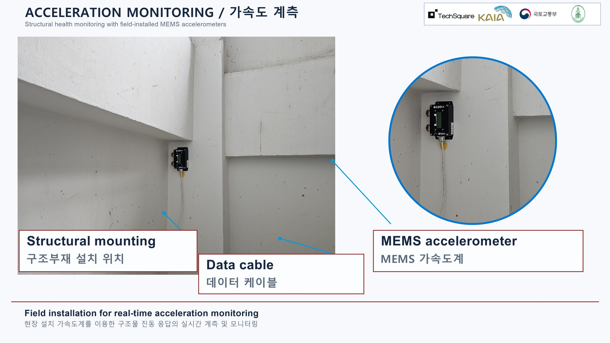
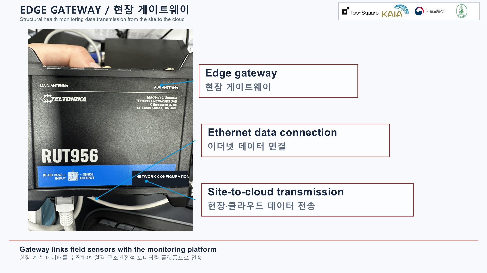
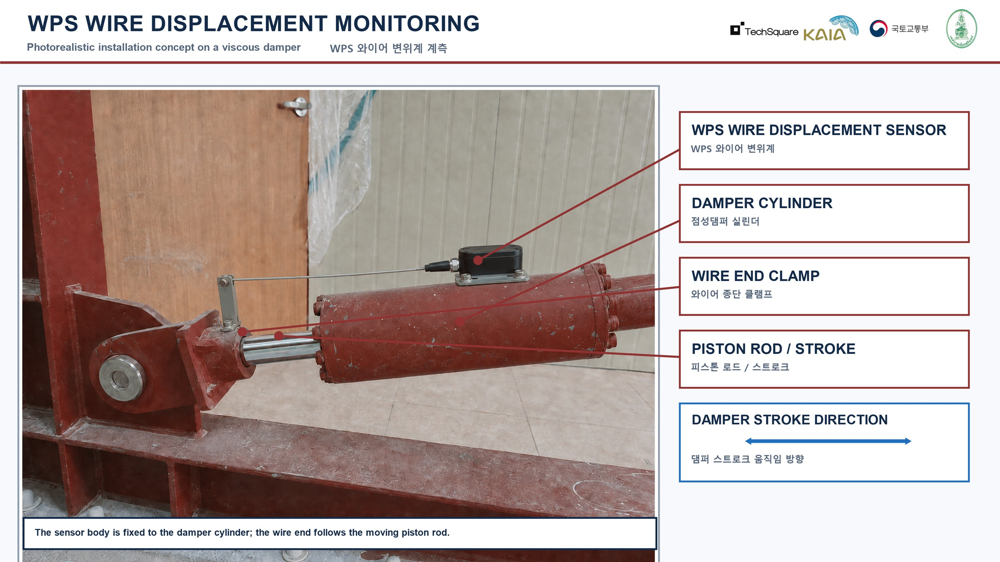

# The project in pictures

[English overview](../README.md) · [한국어](../README.ko.md) · [ภาษาไทย](../README.th.md)

These figures were selected from the project owner's image and exhibition folders. They explain equipment and concepts; they do not establish that the current four-sensor field installation has been completed. Published copies preserve the content, remove EXIF metadata and are resized for web reading. Original files are unchanged. [Image provenance and scope](image-sources.json).

## 1. Acceleration: how the building moves

A provided exhibition figure shows a MEMS accelerometer and mounting context. Four three-axis accelerometers provide twelve acceleration channels. Read the sensor identity, axis, unit and timestamp together. This figure is not a dated acceptance record for the current installation.

**한국어:** 가속도계는 건물의 진동을 관측합니다. 사진 속 설치 맥락과 이번 현장의 최종 위치·방향·시운전 결과는 구분합니다.

**ไทย:** เซนเซอร์ความเร่งใช้สังเกตการสั่นของอาคาร ภาพประกอบนี้ไม่ใช่หลักฐานยืนยันการติดตั้งและทดสอบครั้งปัจจุบัน

## 2. Gateway: how information leaves the site

The provided exhibition figure identifies the gateway hardware and its Ethernet connection. The on-site PC collects and stores measurements; the gateway provides the network path. A connected cable or page response does not prove that samples are advancing or files have reached storage.

**한국어:** 현장 PC가 수집·저장하고 게이트웨이가 통신 경로를 제공합니다. 사진은 현재 통신 성공을 입증하지 않습니다.

**ไทย:** คอมพิวเตอร์หน้างานเก็บและบันทึกข้อมูล เกตเวย์เป็นเส้นทางเครือข่าย ภาพนี้ไม่ได้ยืนยันว่ากำลังส่งข้อมูลสำเร็จ

## 3. Displacement: how a sensor follows damper movement

This is explicitly a **photorealistic installation concept**, not an as-built photograph. It illustrates the sensor body, wire endpoint and piston-rod movement. Actual attachment, movement range, calibration and installation zero must be checked on site. Displacement alone is not a measurement of dissipated energy.

**한국어:** 와이어변위계의 장착 개념도입니다. 실제 시공 사진이 아니며, 현장의 부착·이동 여유·보정·영점을 확인해야 합니다.

**ไทย:** ภาพนี้เป็นแนวคิดการติดตั้ง ไม่ใช่ภาพยืนยันการก่อสร้าง ต้องตรวจจุดยึด ช่วงเคลื่อนที่ การสอบเทียบ และการตั้งศูนย์หน้างาน

## 4. Reference drawings and interface

[Damper component schematic](assets/damper-principle.jpg) · [Reference layout V1R](assets/damper-layout.jpg) · [Historical UI preview, 6 October](assets/dashboard-reference-20261006.jpg)

Layout drawings show proposed positions, not verified final sensor mapping. The historical dashboard screenshot uses synthetic UI inputs and has no operational connection. Latest mobile/QR/language changes are tracked separately from this screenshot. Neither illustrations nor a working dashboard constitute structural-safety certification.
